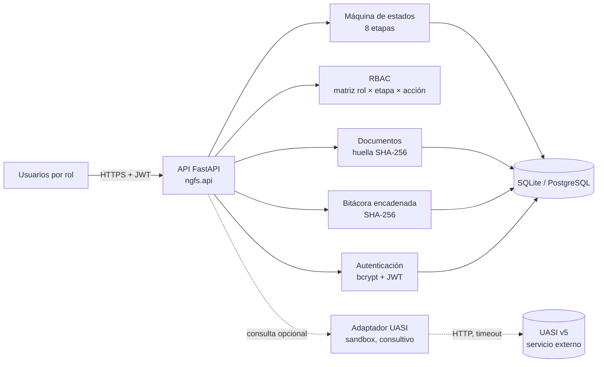

# Arquitectura — NGFS v0.1

NGFSistem (NGFS) es la **capa central de gestión, trazabilidad y auditoría** del ecosistema NESGESFinance. Gestiona
expedientes financieros a lo largo de un ciclo de vida de 8 etapas, con control de acceso por roles, decisiones
humanas obligatorias y una bitácora verificable. UASI v5 es un **adaptador opcional y aislado** que solo aporta
análisis consultivo.

## Módulos

| Módulo | Responsabilidad |
|---|---|
| `ngfs.config` | Configuración por variables de entorno (`NGFS_*`, `DATABASE_URL`); valida secreto JWT en producción. |
| `ngfs.db` / `ngfs.modelos` | SQLAlchemy 2.0: usuarios, expedientes, historial, documentos, análisis consultivos, eventos de auditoría. |
| `ngfs.estados` | Etapas, transiciones explícitas, marcas de decisión humana; genera el diagrama Mermaid. |
| `ngfs.rbac` | Matriz rol × etapa × acción y acciones globales; genera la tabla de `docs/rbac.md`. |
| `ngfs.seguridad` | Hash bcrypt, política de contraseñas, emisión/validación de JWT. |
| `ngfs.auditoria` | Registro encadenado de eventos y verificación de integridad. |
| `ngfs.uasi_adaptador` | Cliente HTTP defensivo hacia UASI v5; sin acceso a BD ni a la máquina de estados. |
| `ngfs.api.*` | Rutas HTTP y dependencias (autenticación, visibilidad, permisos). |
| `ngfs.cli` | `crear-admin` para el usuario administrador inicial. |

## Bitácora encadenada

Cada evento guarda: `secuencia`, `marca_tiempo` (UTC ISO-8601), `actor`, `accion`, `entidad_tipo`, `entidad_id`,
`datos` (JSON canónico), `hash_anterior` y `hash = SHA-256(JSON canónico de todos los campos anteriores)`. El primer
evento enlaza con `GENESIS` (64 ceros). La verificación recorre la cadena y comprueba secuencia, enlace y hash.

**Límites conocidos (v0.1):** la inmutabilidad se aplica en la capa ORM; un administrador de base de datos con acceso
directo podría alterar filas, pero la verificación lo **detectaría**. Para impedirlo (no solo detectarlo) se planifican
permisos/triggers de BD y anclaje externo de la raíz (fases 3 y 6). El cálculo de la secuencia asume escrituras
serializadas; con alta concurrencia la restricción `UNIQUE(secuencia)` hace fallar la transacción en conflicto en lugar
de romper la cadena.

## Documentos

NGFS **no almacena el contenido** de los archivos en v0.1: calcula en streaming su SHA-256 y registra nombre, tipo,
tamaño, etapa y autor. Esto permite demostrar posteriormente que un archivo presentado es idéntico al registrado
(`POST /documentos/{id}/verificar`). El almacenamiento cifrado está previsto en fase 4.

## Adaptador UASI v5 (aislado)

- Desactivado por defecto (`NGFS_UASI_HABILITADO=false`).
- Recibe solo un resumen del expediente (código, título, descripción, monto, moneda, estado y huellas de documentos);
  no envía datos personales del solicitante.
- No recibe la sesión de BD: estructuralmente no puede cambiar estados. Además, la ruta verifica que el estado no
  cambió tras la consulta.
- Cualquier fallo se convierte en `disponible=false`; el flujo de NGFS sigue funcionando.
- El resultado se guarda marcado como `caracter: consultivo` con un aviso explícito.
- **Pendiente:** UASI v5 aún no expone un endpoint específico para NGFS; la ruta es configurable
  (`NGFS_UASI_RUTA_ANALISIS`) y el contrato se definirá en la fase 5.

## Coherencia con UASI v5

Mismo stack base (Python 3.11+, FastAPI, Pydantic, pytest, ruff, mypy), misma organización `src/` y configuración de
ruff compatible. NGFS añade SQLAlchemy porque requiere persistencia relacional de expedientes y usuarios.
