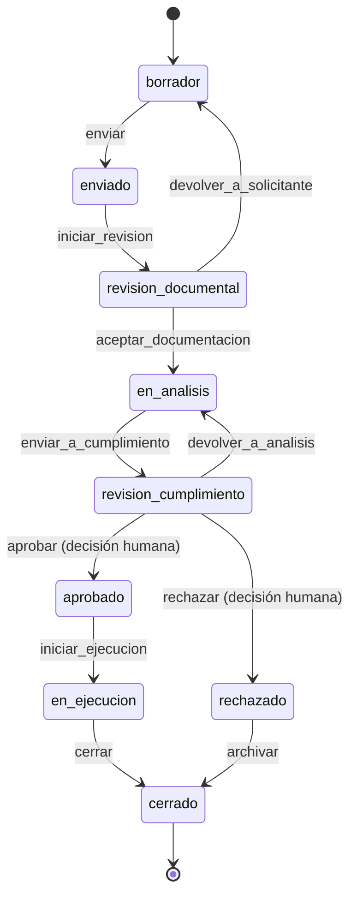

# Máquina de estados de expedientes — NGFS v0.1

> Fuente única de verdad: `src/ngfs/estados.py`. Un test (`tests/test_estados_docs_cli.py`) verifica que el
> diagrama de este documento coincide con el código.

## Etapas

| Etapa | Estado (valor API) | Nombre | Quién actúa |
|---|---|---|---|
| 1 | `borrador` | Borrador | Solicitante/Promotor |
| 2 | `enviado` | Enviado | Analista (toma el expediente) |
| 3 | `revision_documental` | En revisión documental | Analista |
| 4 | `en_analisis` | En análisis técnico/financiero | Analista (puede pedir análisis consultivo UASI) |
| 5 | `revision_cumplimiento` | En revisión de cumplimiento | Oficial de Cumplimiento revisa; el Comité decide |
| 6 | `aprobado` / `rechazado` | Decisión (humana) | Comité/Aprobador |
| 7 | `en_ejecucion` | En ejecución / seguimiento | Analista, Comité |
| 8 | `cerrado` | Cerrado / Archivado | — (estado final) |

## Diagrama

## Tabla de transiciones

| Acción | Desde | Hacia | Roles | Justificación | Decisión humana |
|---|---|---|---|---|---|
| `enviar` | borrador | enviado | solicitante | no | no |
| `iniciar_revision` | enviado | revision_documental | analista | no | no |
| `devolver_a_solicitante` | revision_documental | borrador | analista | **sí** | no |
| `aceptar_documentacion` | revision_documental | en_analisis | analista | no | no |
| `enviar_a_cumplimiento` | en_analisis | revision_cumplimiento | analista | no | no |
| `devolver_a_analisis` | revision_cumplimiento | en_analisis | cumplimiento | **sí** | no |
| `aprobar` | revision_cumplimiento | aprobado | comite | **sí** | **sí** |
| `rechazar` | revision_cumplimiento | rechazado | comite | **sí** | **sí** |
| `iniciar_ejecucion` | aprobado | en_ejecucion | analista | no | no |
| `cerrar` | en_ejecucion | cerrado | comite | **sí** | no |
| `archivar` | rechazado | cerrado | comite, administrador | **sí** | no |

## Reglas

1. **Solo transiciones explícitas.** Cualquier acción no listada para el estado actual se rechaza con `409 Conflict`
   y el estado no cambia.
2. **Rol autorizado.** Si la acción existe pero el rol no está autorizado: `403 Forbidden` (ver [rbac.md](rbac.md)).
3. **Justificación.** Las acciones marcadas exigen un texto de al menos 10 caracteres (`422`).
4. **Supervisión humana (human-in-the-loop).** `aprobar` y `rechazar`:
   - solo las ejecuta una persona con rol `comite` autenticada con usuario y contraseña (token `tipo=humano`);
   - exigen `confirmacion_humana: true` y justificación en la solicitud;
   - aplican **segregación de funciones**: quien presentó el expediente no puede decidirlo;
   - no existe ninguna ruta automática (ni el adaptador UASI) capaz de invocarlas.
5. **Trazabilidad.** Cada transición se guarda en `historial_transiciones` y genera un evento en la bitácora
   encadenada SHA-256.
6. **Estado final.** `cerrado` no tiene transiciones de salida.

## Limitaciones de v0.1

- No hay control de concurrencia optimista (dos transiciones simultáneas sobre el mismo expediente); previsto en fase 3.
- El Comité se modela como un único rol individual; las decisiones colegiadas (quórum, votación) están previstas en fase 4.
